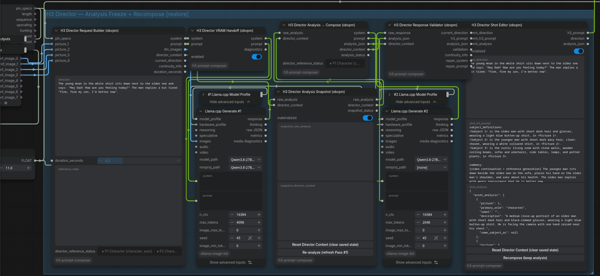

# H3 Prompt Composer / OBVPM Director — v0.6.0rc23

Backend-agnostic two-pass Director nodes for MiniMax H3 Ref2VA in ComfyUI.

The Director owns semantic/visual analysis, continuity reasoning and H3 prompt composition. It does **not** own LLM inference, timeline editing, generation, takes, split/trim/join, Extend/Prepend/Bridge, Motion Context, Recipes or Provenance. Those remain external responsibilities (OBVPM where used).

## See the Director in action

A short, imperfect user direction becomes a reference-grounded, continuity-aware H3 prompt. The input below is reproduced **verbatim, including its typo**. The Director keeps the spoken words intact while resolving the two characters, their reference pictures, the room, camera framing, and speaker IDs.

> [!NOTE]
> **INPUT — raw user direction**
>
> ```text
> The young mnan in the white shirt sits down next to the older one and says: "Hey Dad! How are you feeling today?" The man replies a bit tired: "Fine, fine my son, I'm better now".
> ```

> [!TIP]
> **OUTPUT — structured H3 prompt (selected lines)**
>
> ```text
> <Subject 1> is the older man with short dark hair and glasses,
> wearing a light blue button-up shirt, in <Picture 1>.
> <Subject 2> is the younger man with short dark wavy hair,
> clean-shaven, wearing a white collared shirt, in <Picture 2>.
> <Subject 3> is the rustic living room with stone walls,
> wooden ceiling beams, sofas and armchairs, in <Picture 3>.
>
> <Subject 2> (S1) looks at his father with concern and asks,
> <d>[English] Hey Dad! How are you feeling today?</d>
> <Subject 1> (S2) gazes back at him with a weary, sad expression
> and replies softly,
> <d>[English] Fine, fine my son, I'm better now.</d>
> ```

<details>
<summary><strong>Read the full generated H3 prompt (all six sections)</strong></summary>

```text
subject_definitions:
<Subject 1> is the older man with short dark hair and glasses, wearing a light blue button-up shirt, in <Picture 1>.
<Subject 2> is the younger man with short dark wavy hair, clean-shaven, wearing a white collared shirt, in <Picture 2>.
<Subject 3> is the rustic living room with stone walls, wooden ceiling beams, sofas and armchairs, side tables, lamps, and potted plants, in <Picture 3>.

summary:
[video continuation + reference generation] The younger man sits down beside the older man on the sofa, places his hand on the older man's shoulder, and asks about his health. The older man replies with weary reassurance that he is better now.

retention_analysis:
<Subject 1> (appears in [Shot 1]): fully_preserved - facial identity and the shot-visible defining characteristics are retained.
<Subject 2> (appears in [Shot 1]): fully_preserved - facial identity and the shot-visible defining characteristics are retained.
<Subject 3> (appears in [Shot 1]): fully_preserved - the environment is retained.

detailed_description:
Naturalistic live-action drama with soft, warm indoor light, muted color grading, and a quiet, intimate domestic mood.
[Shot 1] The camera holds a static medium two-shot of <Subject 3>'s living room, where the two men are seated side-by-side on a sofa, with a window with sheer curtains behind them and a potted plant to the right. <Subject 2> is on the left and <Subject 1> is on the right; <Subject 2>'s hand rests gently on <Subject 1>'s shoulder. <Subject 2> (S1) looks at his father with concern and asks, <d>[English] Hey Dad! How are you feeling today?</d> <Subject 1> (S2) gazes back at him with a weary, sad expression and replies softly, <d>[English] Fine, fine my son, I'm better now.</d> The shot ends with both men still seated closely together, the older man's tired face and the younger man's concerned gaze remaining fixed on each other.

overall_soundscape:
Quiet domestic ambience with faint room tone; no music, no significant non-diegetic sound.

non_diegetic_music:
N/A
```

</details>

The character descriptions and living-room details come from the connected picture references and inherited scene context—not from the short user direction alone. This is an actual Director output, not an idealized template.

### OBVPM integration at a glance



The workflow is arranged from **OBVPM inputs on the left** through **visual analysis and prompt composition in the middle** to the **editable, materialized H3 prompt on the right**.

**Try the example:** [Open the portable ComfyUI workflow](examples/H3-Director-Analysis-Freeze-Recompose.json) · [Quick start and installation](#quick-start) · [Release notes](RELEASE_NOTES.md)

The example shows the public Director integration only; it does **not** include proprietary OBVPM Pro generation workflows.

## Quick start

**Status:** `v0.6.0rc23` is a public release candidate (pre-release), not a final stable release.

### Install in ComfyUI

Clone into `ComfyUI/custom_nodes/h3-prompt-composer/` (or extract the repository there) and restart ComfyUI:

```bash
cd /path/to/ComfyUI/custom_nodes
git clone https://github.com/Jinx138/obvpm-h3-director.git h3-prompt-composer
```

The Director itself does not install or bundle an LLM backend, model weights, video generator, or OBVPM Pro workflow.

### Configure the example workflow

The linked example uses external `ollama-image-list` llama.cpp nodes for its two Generate passes; install/configure those nodes separately to run this particular example.

Select your own local model file in **both** Generate nodes, plus a matching `mmproj` for vision-capable **Generate #1**. **Generate #2** is text-only and has no image input or `mmproj` requirement. Choose offloading and model parameters appropriate to your hardware. Connect an H3 / OBVPM generation workflow separately if desired.

**Recommended, not required:** Qwen3.8-27B GGUF models in non-thinking mode were used for our practical tests. The Director's LLM interfaces are ordinary `system`/`prompt` text (plus a separate image list for the vision pass) and can be connected to other compatible providers and ComfyUI inference nodes. Some third-party tuning/quantization/model variants will perform differently; no specific checkpoint is bundled.

**Before reusing a saved/frozen example:** reset Director Context or re-analyze the inputs. Do not rely on a previously frozen Shot State for a new project. See the materialization and reset sections below.

### Requirements and boundaries

- ComfyUI with Python 3.10+ (no extra Python dependencies declared by this custom node).
- A compatible vision-capable LLM/VLM backend for Generate #1 and a text generation backend for Generate #2.
- The bundled example specifically uses the external `ollama-image-list` llama.cpp nodes. These are an **example-only** integration, not a hard dependency of the Director.
- OBVPM is optional for stand-alone prompt composition; OBVPM supplies timeline/pin endpoint information if using Extend/Prepend/Bridge.
- No OBVPM Pro workflows or proprietary OBVPM implementation are distributed here.

For release highlights and current caveats see [`RELEASE_NOTES.md`](RELEASE_NOTES.md).

## Node category

All public Director nodes live under `obvpm/director`. Visible node names use the `(obvpm)` suffix and contain no version number.

## Public modular path

1. **H3 Director Request Builder (obvpm)**
   - builds the Pass #1 semantic/visual analysis request
   - **new rc14:** first extracts explicit Picture-number references from the current user Direction and optional `reference_roles` field; remaining references are interpreted visually (Auto), with no obligatory labels
   - optionally consumes OBVPM `pin_specs` as Director continuity endpoints
   - one `before` pin = Extend, one `after` pin = Prepend, one of each = Bridge
   - outputs numbered reference images first, followed by director-only START/TARGET boundary frames when applicable
   - **rc19:** the existing `duration_seconds` FLOAT input is passed through unchanged as a final `duration_seconds` FLOAT output. OBVPM independently owns frame-grid snapping and overlap calculations. **Graph warning (confirmed in rc20):** do NOT wire this output into the SAME Timeline node that supplies the Request Builder's `pin_specs`. ComfyUI sees a circular dependency because the entire Request Builder also consumes `pin_specs`. Keep the Timeline duration configured there, or split a single upstream FLOAT source into both Timeline and Director. No independent snapping is performed here.

2. **H3 Director VRAM Handoff (obvpm)** *(optional)*
   - unloads ComfyUI-managed models before a local/external GPU LLM runtime
   - transparently passes `system` and `prompt`

3. External **LLM Generate #1 / Analysis**
   - multimodal/vision-capable
   - consumes `system`, `prompt`, and `llm_images`

4. **H3 Director Analysis Snapshot (obvpm)**
   - freezes the raw Pass #1 analysis and its matching Director Context together
   - lazy-blocks Generate #1 and VRAM Handoff while materialized
   - `Re-analyze (refresh Pass #1)` unfreezes this snapshot and connected Shot Editors; execute to refresh both passes
   - the snapshot is a regular intermediate node, not a second independent OUTPUT_NODE
   - `Reset Director Context (clear saved state)` clears both its frozen strings and all Shot Editor values in the currently open workflow; it does not modify Request Builder inputs or OBVPM data

5. **H3 Director Analysis → Compose (obvpm)**
   - parses/stamps the Pass #1 analysis JSON
   - **rc18:** restores explicit, speaker-attributed quoted dialogue directly from the frozen current user Direction. The user-owned wording and order supersede omitted, paraphrased or contradictory `intent.speech_request.utterances` from Generate #1, without changing the Director's staging or decisions
   - **new rc14:** merges Auto and user-defined Picture roles into `reference_contract.picture_roles`, forwards them in the Director Context and Shot Analysis, and updates the compact read-only status in Request Builder/Compose
   - stamps `reference_contract.required_picture_bindings` and `concrete_keyframe_pictures` from connected, resolved pictures and grounded Subjects
   - **rc19:** only shot-visible environment references are mandatory in H3 detailed_description; established close-up backgrounds remain available in the scene contract without forced environment Subjects or artificial establishing shots. Narrowly grounded actor/target pin instructions are recorded in `action_contract`.
   - **rc22:** builds a compact, machine-derived Pass #2 delivery checklist with concrete per-event dialogue text and canonical speaker IDs where Subject identification is unambiguous, plus shot-visible (not offscreen-only) environment bindings. Ambiguous speakers remain unresolved; no text or speaker-ID rewriting occurs here.
   - malformed, truncated, or root-incomplete Pass #1 JSON fails explicitly (including edited frozen snapshots); never falls back to a nested object

6. External **LLM Generate #2 / H3 Composition**
   - **text only**
   - consumes only `system` and `prompt` from Analysis → Compose
   - must not receive the reference-image list

7. **H3 Director Response Validator (obvpm)**
   - **rc18:** independently reasserts the frozen user Direction's verbatim dialogue before live speaker-ID normalization and verification. An empty required `preserve` contract cannot silently pass; unambiguous misattribution to a different reference-backed Subject fails
   - validates six-section H3 syntax, exact Picture→Subject/environment bindings, per-vocal-event speaker IDs, authorized speech wording/order, and task-prefix/keyframe consistency
   - **rc19:** checks explicitly authorized actor/target hand-pin actions and rejects swapped or added reversed pinning; leaves other choreography free to the Composer. Reports failures without inventing or rewriting actions.
   - **rc17 / rc23:** fills in missing `(S1)`, `(S2)`, etc. on the **live, first-pass H3 prompt only** if a speaker is uniquely identified from the preserved user dialogue or a single unambiguous scene Subject; rc23 also recognizes uniquely grounded descriptive speaker labels such as "the younger man" via the existing rc22 delivery resolver, with a local speech-attribution check. IDs follow actual vocal order. Existing conflicting IDs, changed dialogue, ambiguous referents, or incidental Subject mentions remain failures; the normalizer never rewrites words, actions, or frozen Shot Editor text.
   - exposes optional repair `system` / `prompt` strings but owns no inference
   - first outputs deliberately match Shot State live input order: `current_direction`, `h3_prompt`, `analysis_json`

8. **H3 Director Shot Editor (obvpm)** (internal ID unchanged: `H3DirectorShotState`)
   - freezes prompt/analysis/direction as user-authoritative shot state
   - `Recompose (keep analysis)` unfreezes only the final H3 prompt; execute to rerun Pass #2 with a different model
   - changing the final composer model requires pressing `Recompose` if the Shot Editor is already materialized
   - gives the editable H3 prompt 50% of the text-widget area; direction and analysis receive 25% each
   - lazy-blocks the complete LLM branch while materialized
   - reloads cleanly from the saved workflow state
   - when OBVPM is present, automatically resets when authoritative `timeline.next` changes

## Reference role prepass & user correction (rc14)

The user writes a natural **Direction** as before. Pass #1 is instructed to resolve user-mentioned protagonists, locations and objects **before** classifying images, then match those referents against visible picture evidence. For example, `Alex enters the living room` plus Picture 1 showing Alex and Picture 2 showing the room is enough when the vision model identifies them confidently; the Director does not require manual labels. Vague/unresolved matches remain `unknown` instead of being invented.

For critical or ambiguous mappings, fill the **optional** `reference_roles` field in Request Builder, one assignment per line:

```text
Picture 1: Alex (character)
Picture 2: living room (location)
Picture 3: red jacket (object)
```

You can also say `Picture 1 shows Alex` or `Alex in Picture 1` directly in Direction. Explicit Picture-number assignments in the dedicated `reference_roles` field take priority over those from Direction; both override free visual inference. Unconnected Picture slots are ignored. Auto remains the default for unassigned slots. Reference hints are roles, not camera-setup requests: a room reference does not imply a wide shot.

After Analysis → Compose runs, a small non-serialized **Reference status** line on Request Builder/Compose shows the accepted Picture mapping and provenance (`auto`, `auto: user prompt match`, `user prompt`, `user override`, or `unresolved`). It is an observational UI, not an extra control. The actual mappings are persisted in `snapshot_director_context.reference_roles_resolved`, `reference_contract.picture_roles` in the Shot Analysis, and the forwarded Director Context. Safe named reference roles also travel via the existing stable scene contract for subsequent Extend operations, without copying previous action prose.

**To correct a mapping:** edit Request Builder's `reference_roles`, then click **Re-analyze (refresh Pass #1)** in Analysis Snapshot. Merely clicking `Recompose` intentionally retains the frozen analysis and mappings. For a copied workflow with unrelated frozen state, first use **Reset Director Context**. The current implementation is a text-first instruction within the existing vision pass plus deterministic handling of explicit Picture-number labels; it is **not** a new independent text LLM pass or an image classifier. Real-model matching must be confirmed in ComfyUI.

## New project from Save As — full Director reset (rc13)

Copying a workflow with **Save As** also copies the frozen Analysis Snapshot and Shot Editor widgets. `Re-analyze` deliberately only unlocks the gates; it does **not** delete their saved text, so old names and scene details may remain visible in the copied workflow.

Before starting a new project from a copied workflow, finish/cancel queued jobs and click **Reset Director Context (clear saved state)** on either the Analysis Snapshot or Shot Editor. Alternatively, add the optional **H3 Director Reset Context (obvpm)** control node and click its button. All three entry points run the same workflow-wide reset:

- clear `snapshot_raw_analysis` and `snapshot_director_context` on **every** Analysis Snapshot node
- clear `shot_direction`, `shot_h3_prompt`, `shot_analysis` on **every** Shot Editor
- set every corresponding `materialized` gate to `false`
- preserve current Request Builder direction, image/reference connections, LLM/backend settings, and all OBVPM timelines/clips/sidecars
- **do not** execute or enqueue anything automatically; click Execute when ready, then save the new workflow to persist the cleared state

This removes **Director-owned stored text**, not OBVPM timeline history. If the new request still receives an old character or location after resetting and executing, check connected `pin_specs`/OBVPM sidecar references or other external inputs. Do not reset while previous jobs are queued/running: their late UI results can refill the fields.

`Re-analyze` and `Recompose` continue to work as before and do not erase editable data. The `timeline.next` automatic reset is unchanged (unfreeze only, preserve historical materialized text until the next run).

## Backend contract

The Director intentionally contains no LLM client/provider implementation. Any ComfyUI LLM nodes may be used if they satisfy these contracts:

- **Pass #1:** accepts Director `system` + `prompt` and the IMAGE list, returns one STRING response containing the requested analysis JSON.
- **Pass #2:** accepts Director `system` + `prompt`, returns one STRING response containing the final H3 prompt. Pass #2 is text-only.

Provider/model/runtime settings belong to those external Generate nodes, not to the Director core.

## Recommended wiring

```text
Request Builder.system -> [VRAM Handoff.system] -> Generate #1.system
Request Builder.prompt -> [VRAM Handoff.prompt] -> Generate #1.prompt
Request Builder.llm_images ----------------------> Generate #1.images

Generate #1.response -> Analysis Snapshot.raw_analysis
Request Builder.director_context -> Analysis Snapshot.director_context
Analysis Snapshot.raw_analysis -> Analysis → Compose.raw_analysis
Analysis Snapshot.director_context -> Analysis → Compose.director_context

Analysis → Compose.system -> Generate #2.system
Analysis → Compose.prompt -> Generate #2.prompt
# No images are connected to Generate #2.

Generate #2.response -> Response Validator.raw_response
Analysis → Compose.analysis_json -> Response Validator.analysis_json
Analysis → Compose.director_context -> Response Validator.director_context

Response Validator.current_direction -> Shot State.current_direction
Response Validator.h3_prompt -> Shot State.current_h3_prompt
Response Validator.analysis_json -> Shot State.current_analysis
```

## Separate analysis and composition freezes (rc12)

**First run:** Analysis Snapshot `materialized=false`, Shot Editor `materialized=false`. Execute once. The intermediate node captures Pass #1 analysis + Director Context; Shot Editor captures the final H3 prompt. Wait for the UI materialization to finish before queuing another run.

**Compare models for Generate #2:** Leave Analysis Snapshot `materialized=true`. In the Shot Editor click **Recompose (keep analysis)** (or set `materialized=false`), change the Generate #2 model or settings, then execute. Pass #1 stays asleep; Generate #2 works from exactly the saved analysis and context. Repeat for each comparison. Editing the saved `snapshot_raw_analysis` is possible, but it changes the experimental baseline.

**Run a new visual analysis:** Click **Re-analyze (refresh Pass #1)** in Analysis Snapshot, then execute; connected Shot Editors are also unfrozen. Alternatively reset both `materialized` switches manually. On an authoritative OBVPM `timeline.next` change, the frontend resets **both** freeze switches automatically. A manual user change to Direction or Pictures does not silently invalidate a deliberately frozen analysis; explicitly re-analyze in that case.

**Final production/Seed Hunt:** Once satisfied, leave the Shot Editor `materialized=true`. Its lazy input barrier stops both passes. Use the same approved prompt for all seed trials. For a newly planned shot, first run the Director once, inspect/edit/freeze, then launch Seed Hunt to avoid redundant upstream work in already-queued candidates.

**Compatibility:** The Shot Editor's internal `H3DirectorShotState` class, widget names and shot-state schema remain unchanged. Old workflows load, but they cannot freeze Pass #1 separately until the Analysis Snapshot node is inserted. No OBVPM Pro workflow is bundled.

## rc16: deterministic output contracts and controlled repair

For each connected reference used by the normalized analysis, `reference_contract.required_picture_bindings` records the accepted Picture number, role, and optional linked Subject IDs. A character Subject must cite its exact source `<Picture N>` in `subject_definitions`. An environment may remain a Picture-only location reference, in which case the shot description cites `<Picture N>` directly. An environment Subject is optional; if present, it must cite the Picture in its definition and participate in `detailed_description`. A 360-degree room panorama supplies spatial identity **without** forcing panoramic camera framing.

`reference_contract.concrete_keyframe_pictures` contains connected `end_keyframe` slots. Only these authorize `keyframe completion` in the summary prefix; `target_perspective` remains soft guidance and does not authorize that task type. For every `<d>[Language] ...</d>` vocal event the composer must identify its source with a stable `(Sx)` marker. `speech_request.mode=preserve` additionally verifies the exact words, order and count.

**Failure semantics:** invalid or incomplete Pass #1 JSON raises at Snapshot or Compose (including manually edited frozen analysis). Before validation, the live Response Validator may **only insert missing, unambiguously grounded (Sx) markers**; it does not correct wrong markers, dialogue, actor/target roles, camera prose, or environment references. Other contract violations produce `FAIL` plus optional repair instructions. No repair LLM is executed. Do not approve/materialize a failed draft until corrected. Frozen Shot Editor text is not rewritten.

**Compatibility:** Node IDs/ports, lazy barriers, Shot Editor behavior, `obvpm/director` category, and H3 six-section grammar remain unchanged. The interchange version is still v4. The original `reference_contract.picture_roles` and `allowed_subjects` are preserved; two optional additive fields were introduced. External LLM nodes and OBVPM own inference and media execution, respectively.

**Tests:** `python -m unittest discover -s tests -p 'test_*.py' -v` and `node --test tests/test_reset_frontend.cjs tests/test_reference_frontend.cjs`. Regression fixtures are intentionally synthetic and do not publish anyone's scene prompts or reference images.

## Analysis policy

Visual analysis follows **open observation space, strict evidence threshold**:

- analysis is not a feature checklist to fill
- ambiguous, overlapping, non-exclusive, occluded or insufficient evidence must not be forced into one categorical answer
- image-local observations must not silently become stable subject identity facts
- visual appearance alone must not become communicative intent or semantic dialogue

## Dialogue authority

Concrete invented dialogue/monologue is user-authoritative content.

- If the user explicitly asks to invent dialogue, monologue, speech or spoken lines, Pass #1 must plan concrete wording and Pass #2 must emit the actual words as canonical `<d>[Language] ...</d>` content.
- If the user supplies exact wording, it is preserved as authoritative speech.
- Otherwise the Director may plan conversational topic, subtext, turn-taking, reactions and communicative behavior, but it must **not invent quoted words**.

## Continuity contract

OBVPM remains authoritative for continuation execution. The Director only interprets supplied pin specs semantically:

- **Extend:** START endpoint from the `before` pin.
- **Prepend:** TARGET endpoint from the `after` pin.
- **Bridge:** START + TARGET endpoints from one pin on each side.

Boundary frames are Director-only visual evidence and never become H3 `<Picture N>` labels. Materialized endpoint H3 prompts are authoritative for stable inherited facts and Subject/reference mapping; their completed action is history, not choreography to replay. Endpoint analysis is supporting history. Across continuity operations, inherited `<Subject N>` numbering and source-picture mapping stay stable unless current user intent or current numbered references explicitly change them.

## Stable interchange contracts

- `obvpm.director.context` schema version `4`
- `obvpm.director.analysis` schema version `4`
- `obvpm.director.shot_state` schema version `1`

Package version and interchange-schema versions are intentionally independent.

## Dependencies

The package adds no provider/runtime dependency. It uses libraries already supplied by a normal ComfyUI installation for image/video/sidecar handling.

## Legacy policy

The pre-v0.6 all-in-one llama.cpp architecture and legacy state carriers were development steps toward the modular design and are intentionally not shipped in rc6. No compatibility contract is provided for those development-only nodes.


## Stable scene continuity (rc8)

Continuity operations inherit a small non-temporal scene contract: stable Subject/reference mappings plus structured environment/location facts. Previous action, dialogue, camera trajectory, and other temporal choreography remain excluded from later LLM requests. The physical boundary frame defines the seam; the current user direction drives the new interval. An established environment remains the same location through close-ups or depth-of-field changes rather than becoming a generic backdrop.


## POV embodied-viewer rule (rc11)

In first-person POV, an active `viewer` remains the off-camera camera-holder by default. Viewer actions may be shown through POV-compatible partial body presence (hands, forearms, breath, contact, etc.) without turning the viewer into a second fully visible figure. Phrases such as `two figures`, `both faces`, or `their faces` are therefore inappropriate when only one complete referenced person is on screen and the viewer is represented only through first-person body parts. The viewer becomes a full visible person only when the current user direction explicitly reveals that body (for example via mirror/reflection or a deliberate POV break).

## POV neutral-framing rule (rc10)

`POV` defines viewpoint only; it does not imply a close-up, zoom, push-in, dolly-in, or field-of-view change. The Director keeps the established viewing distance and camera logic unless the current user direction explicitly requests tighter framing/movement or the physical action itself brings a subject/object close to the virtual eye. A subject looking toward the viewer is therefore not enough to turn the shot into a close-up.

## POV reference boundary (rc9)

`viewer`, POV, and camera-holder wording is treated as viewpoint/action semantics rather than an automatic H3 reference Subject. `<Subject N>` remains reserved for content backed by a connected numbered reference. An already referenced Subject may explicitly own the POV (for example, `the camera is the POV of <Subject 2>`), but the viewpoint role itself never creates an extra Subject. Unreferenced POV owners therefore stay out of `subject_definitions` and `retention_analysis`.


## rc15 note: end-picture semantics

Two end-oriented picture roles are now distinguished:

- `end_keyframe`: a hard last-frame / terminal anchor.
- `target_perspective`: a softer `reference generation` target for the latter part or end of the shot. The prompt should move toward a similar angle, framing logic and spatial relationship, but not promise an exact final-frame reproduction.

## Current portable example

Load [`examples/H3-Director-Analysis-Freeze-Recompose.json`](examples/H3-Director-Analysis-Freeze-Recompose.json) as the **Director-only** reference workflow. Generate #1 is multimodal/vision analysis (`max_tokens=4096` in the example); Generate #2 is strictly text-only (`max_tokens=2048`). Choose your locally available models and matching `mmproj` for the first pass. It includes no OBVPM Pro workflow, private images or generation/timeline nodes. It does not invoke an automatic third repair LLM.

## rc17 — speaker IDs without extra LLM calls

This patch changes the existing Response Validator, not the LLM nodes, materialization widget protocol, or the H3 grammar. The Validator copies the live H3 prompt, inserts a missing `(Sx)` immediately after an existing, reference-backed `<Subject N>` mention only if the relevant speaker is identified unambiguously, and runs the normal checks against that output. `validation` includes an `AUTO-NORMALIZED` diagnostic when insertions occur. The normalized `h3_prompt` output is the value stored at the **next live materialization**; already frozen or manually edited Shot State text is not altered.

For `speech_request.mode=preserve`, the full ordered user utterance list must match the generated `<d>` events verbatim before any correction is attempted; the user-provided speaker names must resolve to unique non-environment Subjects. If attribution cannot be established, or an existing ID is inconsistent, the output is left alone and the usual validator FAIL / optional repair instructions apply. An offscreen or unnamed `viewer` is never created as a Subject. A third Repair Generate node is **not** required.

**Upgrade:** Replace the `h3-prompt-composer/` custom node directory and restart ComfyUI. Keep the existing workflow (including rc16 portable examples) and the two Generate nodes. For a newly normalized result, click `Recompose (keep analysis)` once if the Shot Editor is currently frozen. Do not attach an independent Show Text viewer to the upstream live `validation` output when your aim is to inspect or edit a frozen shot without triggering Generate #2.

## rc18 — User dialogue authority (no new node)

The **current user Direction** is authoritative for concrete quoted speech. For
example, `Aster says: "What is that?"` and `Bryn replies: "A small planet."`
on separate lines are parsed deterministically, with the exact words and
speaker order retained. Common `says`/`asks`/`replies`/`answers`/`responds`/
`whispers`/`shouts`/`murmurs` variants are supported. Plain conversational
prose or unattributed quotations do **not** authorize invented words.

The Request Builder records `authoritative_dialogue` inside its existing Director
Context. Analysis → Compose reconstructs the contract from that context even if
Pass #1 returns `speech_request.utterances: []`. Response Validator also reads
the frozen Direction independently and refuses wrong wording or attributable
speaker swaps. It may insert missing `(Sx)` only where the speaker can be
identified safely. Ambiguous/malformed freeform dialogue is not guessed: for
reliable verbatim handling use one `Name says: "..."` line per utterance.

Already materialized Shot Editor text is never changed by this normalization;
its existing lazy freeze semantics remain intact. No extra LLM or workflow update
is required. For a newly authoritative Analysis, refresh Pass #1; for an old
frozen Analysis with the same Direction, `Recompose (keep analysis)` also applies
the rc18 normalization on the way into Pass #2.
