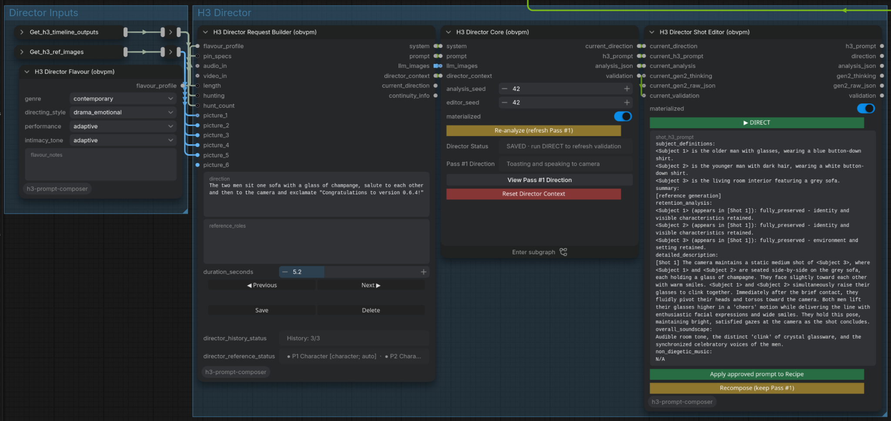
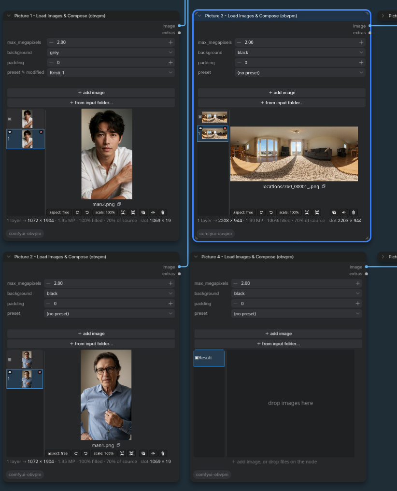
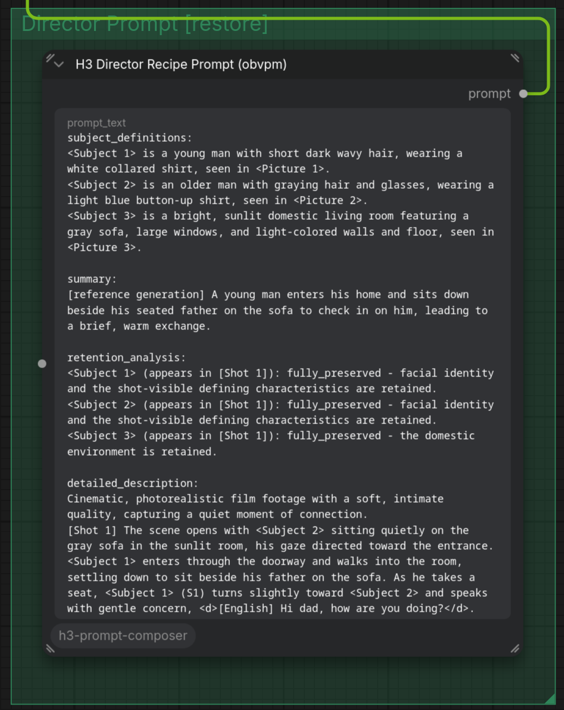

# OBVPM Director

**Direct the scene. Keep control of the prompt.**

OBVPM Director adds a practical directing layer to **MiniMax H3 Ref2VA in ComfyUI**. Describe a scene in natural language, supply reference images, and develop it into a structured H3 prompt with recognizable characters, coherent environments, purposeful action, and shot-to-shot continuity.

The workflow is built for **hands-on directing**: inspect the visual analysis, refine the shot, edit the resulting prompt, and freeze an approved version for consistent video generations and Seed Hunt.

**Director workspace:** Flavour + Request Builder → Director Core (native subgraph) → Shot Editor → optional Recipe Prompt.

**[Quick start](#quick-start)** · **[Open the example workflow](examples/H3-Director-Core-Workspace.json)** · **[Release notes](RELEASE_NOTES.md)**

## What you can do

- **Direct in your own words.** Describe gestures, intent, blocking, camera movement, dialogue, and atmosphere. The Director translates the direction into H3's structured prompt format.
- **Shape the performance.** Select a genre, directing style and performance settings with the required Flavour node. Selected Flavours provide focused creative direction, with a lean universal contract and a Composer that carries the Analyst’s performance, camera and timing details into the H3 prompt.
- **Use visual references.** Build scenes around specific characters, locations, and objects, with automatic picture-role analysis and optional explicit assignments.
- **Maintain continuity.** Use OBVPM's Extend, Prepend, and Bridge context to keep identities, spaces, and unfolding action coherent between shots.
- **Refine before generating.** Review the analysis and validator feedback, then edit the final prompt directly.
- **Freeze a good shot.** Keep the analysis while trying another composer, or preserve the approved prompt across multiple seeds.
- **Work with OBVPM Recipes.** Save and restore a shot's literal generation prompt through a dedicated Recipe Prompt node, independently of the Director workspace.

The Director handles scene semantics, reference roles, dialogue, camera logic, continuity reasoning, and H3 prompt composition. **OBVPM handles the timeline, generation, takes, editing, Recipes, Motion Context, and provenance.** Your preferred compatible LLM nodes perform the two inference passes.

## What’s new in v0.6.6

The Director now uses leaner, positively phrased instructions and selected Flavour skills to give the Analyst more cinematic freedom while preserving explicit user intent, reference bindings and dialogue. The Composer focuses on carrying the Analyst’s direction into H3 rather than re-directing the scene. The prompt assembler is separated from editable skill files and deterministic contracts. Returning speakers retain their original vocal IDs.

**After upgrading:** restart ComfyUI, hard-refresh the browser, then use **Re-analyze → DIRECT** to capture an analysis with the new skill manifests. Existing approved prompts remain available until you choose to refresh them. See the [release notes](RELEASE_NOTES.md) and [skill architecture](docs/SKILL_ARCHITECTURE.md).

## Credits and acknowledgements

Special thanks to **[chanon](https://github.com/chanon)** for creating and developing **[ComfyUI-OBVPM](https://github.com/chanon/comfyui-obvpm)** and **[OBVPM Timeline](https://github.com/chanon/comfyui-obvpm-timeline)**. Their work on H3 video generation, timeline editing, and continuity made this companion directing workflow possible.

**OBVPM Director is an independent, complementary project** focused on scene direction, visual reference analysis, prompt composition, and continuity reasoning. It integrates with OBVPM's interfaces; it does not bundle OBVPM's implementation or Patreon-exclusive Pro workflows.

## From direction to H3 prompt

```text
Flavour + Direction + Reference Pictures + optional OBVPM context
                         │
                Director Request Builder
                         │
             Generate #1 — visual analysis
                         │
                   Analysis Snapshot
                         │
                   Analysis → Compose
                         │
             Generate #2 — H3 composition
                         │
                   Response Validator
                         │
                Editable Shot Editor
                         │   Auto-copy / Apply
                         ▼
                Literal Recipe Prompt ──→ H3 / OBVPM generation
```

The first pass examines image references and scene intent. The second composes the H3 prompt from the analyzed scene. Both Generate stages use external LLM/VLM nodes; the Director supplies their instructions and validates the result.

### A short direction, a complete scene

With reference images of a young man, his father, and their living room, a Direction can be as simple as:

```text
A young man enters the room and joins his father sitting on the sofa,
saying "Hi dad, how are you doing?"
```

The Director associates the references with the people and location, develops blocking and camera language, and produces the six-section H3 prompt. The dialogue contract requires quoted user dialogue to retain its exact wording; review the validator report before approving a prompt. You can also explicitly ask the Director to write dialogue for a scene.

Open the result in **H3 Director Shot Editor (obvpm)**, adjust anything you wish, and materialize the approved version. That prompt remains available for later seed trials and shot generation.

### Director workspace in OBVPM



The screenshot shows the Director integrated into an existing OBVPM workflow, with a saved analysis and editable materialized prompt. The portable example contains the Director workspace, not the OBVPM Pro workflow shown here.

## Quick start

### 1. Install the Director

**ComfyUI Manager (recommended):** Search for **H3 OBVPM Director** (`h3-obvpm-director`) in the Custom Nodes Manager and install or update to **v0.6.6**. Restart ComfyUI and refresh your browser. If the Manager still shows an older version, check whether v0.6.6 has been published to the Comfy Registry; a GitHub commit alone does not update the Registry.

**Manual GitHub alternative:** Clone into ComfyUI's `custom_nodes` directory, keeping the folder name `h3-prompt-composer`:

```bash
cd /path/to/ComfyUI/custom_nodes
git clone https://github.com/Jinx138/obvpm-h3-director.git h3-prompt-composer
```

Do not install both the Manager package and a GitHub clone in the same ComfyUI instance. Restart ComfyUI and refresh your browser. The nodes appear under **`obvpm/director`** and use the `(obvpm)` suffix in their names.

**Requirements:** ComfyUI with Python **3.10+**, a vision-capable Generate node for Pass #1, and a text Generate node for Pass #2. The Director uses the normal ComfyUI Python environment. OBVPM adds timeline continuity and Recipe integration when you use those features.

### 2. Load the portable Director workspace

Open **[`examples/H3-Director-Core-Workspace.json`](examples/H3-Director-Core-Workspace.json)** in ComfyUI. This is the single supported example for v0.6.6. Copy the complete Director block into your own workflow and configure the models inside **H3 Director Core (obvpm)**. Keep the Recipe Prompt in its separate `[restore]` group for OBVPM integration. The Flavour node is required and stays alongside Request Builder. Existing flat workflows can still use the modular nodes, but must connect Flavour and refresh old analysis snapshots.

Its Generate nodes use the external **`ollama-image-list` llama.cpp** integration. Configure that integration, or connect your own compatible LLM nodes:

- **Generate #1 — Vision:** connect `system`, `prompt`, and reference images. For a compatible llama.cpp VLM, select the corresponding `mmproj` projector.
- **Generate #2 — Composition:** connect `system` and `prompt` to your text model.

Choose your locally available models and hardware profiles. The two-pass interface also supports other compatible ComfyUI inference backends.

**llama.cpp setup in brief:** The example uses the current Model Profile, Create Native Session and Generate nodes, with separate Model and Prefill Profiles for both passes. Install the supported multimodal llama-cpp-python fork as described by the nodepack. Configure the GGUF, projector and context on each Create Native Session node; keep `session_unload` enabled on both Generate nodes. Install [ComfyUI-llama-multimodal](https://github.com/craftingmod/ComfyUI-llama-multimodal) separately and follow its runtime and GPU setup instructions. GGUF downloads are available from model publishers and quantizers such as [mradermacher](https://huggingface.co/mradermacher/models). Place models under `ComfyUI/models/LLM/` or configure an additional LLM path, then refresh/restart ComfyUI.

- **Pass #1:** vision-capable GGUF + matching `mmproj`; start with `n_ctx=8192`. Increase only when the full request needs more context and memory allows.
- **Pass #2:** text GGUF, `mmproj=[none]`. Choose a model-specific profile independently for each pass (e.g. a Gemma-compatible profile/handler vs Qwen 3.5+ Non-thinking); disable thinking where supported for clean structured outputs.
- **Prefill / hardware:** start with `n_batch=1024` (try 512 if memory is tight), `n_ubatch=0`, image token limits at 0 (no explicit override). Adjust GPU layers and KV-cache types for your actual memory budget. These are starting points, not VRAM requirements. Director vision scaling is independent of prefill.

See the [official llama.cpp multimodal guide](https://github.com/ggml-org/llama.cpp/blob/master/tools/mtmd/README.md). The Core example also contains a short Markdown setup note inside the subgraph. Neither GGUF models nor OBVPM Pro workflows are bundled.

### 3. Add references and describe the shot

Connect your characters, environments, and objects to the Request Builder's **Picture** inputs. The current UI supports up to **nine numbered Picture inputs**, adding slots as needed. Write the action and desired camera behavior in **Direction**. The Request Builder preserves existing serialized socket indices. Additional Picture sockets are appended as needed, without moving or removing saved sockets; ComfyUI owns the connectable `duration_seconds` widget lifecycle.

The vision pass resolves picture roles automatically. For precise or ambiguous assignments, use the optional `reference_roles` field:

```text
Picture 1: Alex (character)
Picture 2: his father (character)
Picture 3: living room (location)
```

The accepted mappings appear in the reference status. Location references provide spatial and visual grounding while your Direction controls framing.

**Vision input scaling:** The Request Builder limits each image sent to Generate #1 to **1,000,000 pixels or less**, preserving its aspect ratio and never upscaling. This includes image-based continuity frames. It does not modify the original Picture inputs or the references supplied to H3 generation, and empty Picture sockets need no placeholder/scaler nodes. Scaling diagnostics are available under `vision_input_scaling` in `continuity_info`.

**Workflow-local prompt history:** Use the Request Builder's **Save / Previous / Next / Delete** controls to revisit saved `direction` + `reference_roles` combinations. Successful executions can automatically record combinations; state is persisted inside the saved workflow's Request Builder properties (`director_request_history_v1`), not in a shared global file. Save the ComfyUI workflow to keep those entries across reloads. The history does not itself restore generated prompts or change the Recipe.



In standalone mode, edit the `duration_seconds` widget or connect an optional **FLOAT `duration_seconds` socket**. With OBVPM Timeline 0.5.2, connect its **Unbundle `length`** (24-fps frame count) to the Request Builder's optional `length` input; connected `length` takes priority over the FLOAT value. Leave the Timeline's own `duration_seconds` widget available to Regenerate.

### 4. Analyze, compose, and approve

Select **DIRECT** in Shot Editor, review the prompt, and check Director Status in Core. The status indicates basic graph compatibility and validation; it is not a version-aware backend compatibility checker or a guarantee of video quality. The Analysis Snapshot and Shot Editor can materialize their text into the saved ComfyUI workflow.

- **Re-analyze (Core):** invalidate the saved analysis and downstream shot; the next DIRECT refreshes both passes.
- **Pass #1 Direction (Core):** inspect the compact preview or select View Pass #1 Direction to read the captured Analyst action, performance, coordination, camera and sound plan without the reference inventory or Subject definitions. No additional inference; an unfrozen snapshot is explicitly marked as previous/pending refresh.
- **View Status (Core):** open the captured validator report and basic wiring/snapshot diagnostics without running inference. `PASS · repaired` means the final validation passed after deterministic normalization; remaining failures stay `FAIL`, warnings stay `WARNING`. An environment correctly bound to its Picture in Subject definitions but not explicitly cited in shot prose is advisory; missing or incorrect source bindings remain errors. Saved or edited prompts are explicitly distinguished from current validation.
- **Recompose (keep Pass #1):** generate another prompt from the same saved analysis, for example with different Generate #2 settings.
- **Materialized Shot Editor:** reuse the approved prompt for seed comparisons and repeated generation.
- **▶ DIRECT (Shot Editor):** targeted execution of the current Shot Editor and its required dependencies only. If the editor was materialized, the button releases its freeze before the targeted run; a separately materialized Analysis Snapshot stays frozen. This is not a full workflow Run and does not deliberately launch H3 generation or Seed Hunt. The integrated frontend queue guard restores the partial-execution target if an extension drops it and silently suppresses duplicate submissions during the targeted request.
- **Reset Director Context (Core):** clear stored Director analysis and shot text when starting a different project from a copied workflow. The Recipe Prompt maintains its own saved text.

## OBVPM Recipe integration

With OBVPM Timeline 0.5.2, a **H3 Director Recipe Prompt (obvpm)** node holds the literal H3 prompt associated with a planned or generated take. OBVPM can save and restore this prompt as you navigate the timeline, while the Director workspace remains available for working on the next shot.



The [Core workspace](examples/H3-Director-Core-Workspace.json) keeps these responsibilities separate:

| ComfyUI group | Contents | Role |
|---|---|---|
| `Director Inputs` and the adjacent Core / Shot Editor | Flavour, Request Builder, native Core subgraph, Shot Editor | Current shot development; outside `[restore]` |
| `Director Prompt [restore]` | `H3 Director Recipe Prompt (obvpm)` | Shot-specific prompt restored by OBVPM |

Keep **only the Recipe Prompt node** inside a group whose title contains `[restore]`. Connect the Recipe Prompt's `prompt` output **directly** to the H3 conditioning prompt input in your OBVPM generation workflow. OBVPM can then capture the approved text with the queued take.

### Preparing and generating a new shot

1. **Choose a new NEXT RUN.** A fresh Extend, Prepend, or Bridge reservation—or the next Root after a newly appended Root take—prepares a new Recipe destination and releases the Director's analysis/shot freeze gates. Existing shot states remain available in their respective timeline records.
2. **Queue the Director.** Run the two-pass Director branch and materialize the approved prompt in Shot Editor. For a fresh reservation with exactly one Recipe Prompt node and an empty Recipe field, the completed prompt is copied there automatically.
3. **Review the Recipe.** Edit the literal text directly, or select **Apply approved prompt to Recipe** in Shot Editor to transfer a chosen version. Automatic transfer operates on an empty Recipe field; manual Apply lets you deliberately replace its contents. Apply turns green when the editor is frozen, its prompt is non-empty and a Recipe destination exists.
4. **Queue H3 generation.** Once the Recipe contains the desired text, run your H3/OBVPM generation workflow. OBVPM records the literal prompt with the queued take.

The **two-stage queue sequence** gives you an opportunity to approve the direction before video generation. For Seed Hunt, materialize a single prompt and keep its Recipe text fixed while trying different seeds. The optional Request Builder `hunting` and `hunt_count` inputs accept OBVPM Unbundle diagnostics; **they do not control or disable OBVPM Hunt**. A regular ComfyUI **Full Run** follows OBVPM's own generation/Seed Hunt rules.

**Avoid bypassing the freeze:** If a separate output/diagnostic node (e.g. Show Text) consumes Generate #1 or Generate #2 directly, executing that branch can re-run the LLM even when Analysis Snapshot and Shot Editor are both materialized. Disconnect such diagnostics when performing a full H3/Seed Hunt run, or feed them from the saved snapshot instead.

Selecting historical clips restores their saved Recipe prompts through OBVPM while preserving the independent Director workspace for new creative work.

## Continuity, dialogue, and viewpoint

**Extend, Prepend, Bridge.** The Director uses OBVPM's START boundary for Extend, TARGET boundary for Prepend, and both endpoints for Bridge. Boundary frames provide visual context; H3 Picture numbers continue to identify the explicit reference inputs. Stable people, settings, and spatial relationships carry forward as new action unfolds. Current accepted reference ownership takes precedence over historical shot-local Subject numbers; conflicting or ambiguous endpoint identities are not silently merged.

**Dialogue authority.** Exact spoken lines supplied in Direction retain their wording and order. The dialogue contract reconciles literal user quotations with the Analyst’s structured speaker plan, rather than replacing that plan with a partial lexical parse. Unresolved explicit speech is reported rather than silently dropped. When you explicitly request new spoken lines, the Director can compose them. Speaker-attributed text such as `Alex says: "..."` helps preserve the correct voice assignment. Explicitly shared lines (e.g. `Alex and Sam exclaim in unison: "Cheers!"`) are expanded into separate canonical dialogue events when both speakers are unambiguously reference-backed; ambiguous collective bindings are reported instead of guessed. Timing itself remains a model-dependent performance instruction. The live Vocal Event Normalizer shares a delivery vocabulary with Dialogue Authority and can restore missing speaker IDs and canonical dialogue tags when the already-staged words, speaker, language and ordering are unambiguous. It can also normalize clearly attributed postfix speaker IDs and restore a single added terminal period or exclamation mark to the exact authorized punctuation. It leaves changed or omitted words, unresolved attribution and unbalanced tags for validation; it never rewrites frozen edits.

**POV.** The reserved `viewer` represents the first-person camera viewpoint. Hands, arms, and direct physical interaction can be described from that viewpoint. Camera distance and perspective follow your current Direction and established scene context.

**Target references.** `target_perspective` guides the composition toward a desired later viewpoint; `end_keyframe` represents a concrete final-frame anchor. The generation workflow determines the actual image-conditioning behavior.

**Validation.** The validator checks H3 structure, reference assignments, dialogue attribution, and continuity contracts. Its diagnostics help you catch inconsistencies before approving a shot. Visual quality and motion remain dependent on the generation model and settings.

## Known limitations

- The Core status checks basic wiring and captured prompt validation, not backend versions or generated video quality. Review remaining warnings or failures before applying an approved prompt.
- If a particular ComfyUI reload restores the materialized switch but not its saved analysis text, turn off materialization or use **Re-analyze**, then run DIRECT again. The snapshot serialization fix has automated regression coverage; persistence across all frontend versions and OBVPM restore paths is not certified.
- Indirect speaker attribution and classification of additional quoted text depend on the structured Analyst output. Malformed Pass #1 JSON is rejected; re-analyze with a different seed if needed.
- Simultaneous speech is model-dependent; separate correctly attributed dialogue events do not guarantee overlapping audio.
- The full Director Context is currently workflow-local. OBVPM's separate Recipe Prompt restore mechanism remains available; per-timeline/per-version Director Context storage is planned, not implemented.

See [ROADMAP.md](ROADMAP.md) for follow-up work.

## Workflows and compatibility

- **ComfyUI / Python:** Python 3.10+ with suitable external vision and text Generate nodes.
- **Example backend:** `ComfyUI-llama-multimodal` llama.cpp with local model and hardware configuration; other compatible backends can be connected.
- **OBVPM integration:** Recipe synchronization and timeline continuity were developed with **OBVPM Timeline 0.5.2**.
- **Example workflow:** [H3 Director Core Workspace](examples/H3-Director-Core-Workspace.json). The older flat examples are superseded. Existing saved workflows are not deleted.
- **Upgrade from v0.6.4:** restart ComfyUI, hard-refresh the browser and use Re-analyze before DIRECT to rebuild the dialogue and continuity contracts. Existing Core wiring is unchanged.
- **Upgrade from v0.6.3:** install the current llama.cpp nodepack for the bundled example; copy the new workspace, configure both sessions and reset/re-analyze old snapshots. The Flavour input is now required.
- **Video tutorial (previous UI):** [Original OBVPM integration walkthrough](https://youtu.be/jMFrAsUYXUQ). The current Core layout and native sessions supersede its Director setup screens.

**[MIT License](LICENSE)** · **[Release notes](RELEASE_NOTES.md)** · **[Changelog](CHANGELOG.md)**
